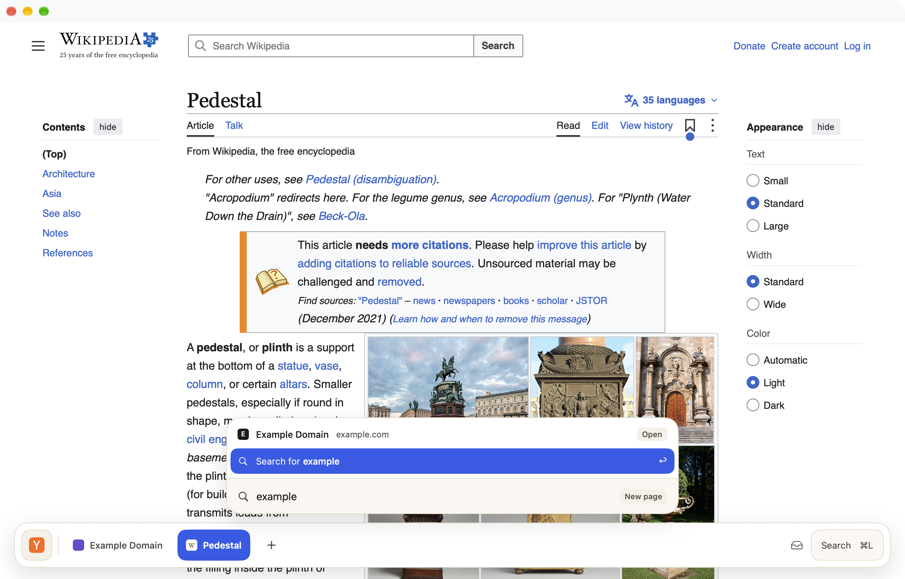

<p align="center">
  
</p>

# Plinth

A native macOS browser built with Swift and WebKit. It has no toolbar and no tab strip. The page runs to the top of the window, and the only chrome is a floating bar at the bottom that lists your open pages by name, grouped by website. Sites you stop using fade out and drop onto a searchable shelf.

<p align="center">
  
</p>

## Features

- **Bottom bar.** Pages are listed by name and grouped into one capsule per website. Drag to reorder, or drop one page on another to show them side by side.
- **Adaptive fading.** A site you use every day stays on the bar; a one-off search fades within a day or so. Kept and pinned sites never fade.
- **Shelf.** Faded sites go to a searchable shelf, and you can bring them back with their state intact.
- **Pinned sites.** Each pin is a small resident app with one page. A link that leaves the pin's site opens as an ordinary page, and sign-in flows still work.
- **Split view** with a draggable divider.
- **Command bar** (⌘L) for addresses, search and switching pages.
- **Peek** (⇧-click a link) previews it without leaving the page.
- **Mini window** for links opened from other apps; ⌘⇧↩ moves the page into the main window.
- **Group suggestions.** When the same sites keep being open together, Plinth suggests grouping them. One click shows only that group.
- **On-device AI**, using Apple's Foundation Models and NaturalLanguage frameworks. Nothing leaves your Mac, and one switch turns all of it off.
  - **Resume cards:** "where you left off" when a site comes back from the shelf.
  - **Ask page / ask site** (⌘J): ask about one page, every page of a site, or compare the two halves of a split.
  - **Semantic history:** find pages you read by what they were about, not just by their words.
- **Built-in content blocking**, a downloads indicator, find in page, and zoom.
- **iCloud sync** of pins, the shelf and history, plus each Mac's open pages as a read-only list. It is built and tested, but off by default; see [Design/icloud-sync.md](Design/icloud-sync.md) to turn it on.

## Requirements

- macOS 26
- Xcode 26 (Swift 6.2)
- The AI features need an Apple Intelligence–capable Mac with Apple Intelligence turned on. Everything else works without it.

## Build and run

```bash
swift build
```

```bash
swift test
```

```bash
Scripts/bundle.sh
```

`Scripts/bundle.sh` builds `build/Plinth.app` and signs it ad hoc. Open it with:

```bash
open build/Plinth.app
```

If `xcode-select` points at the Command Line Tools instead of Xcode, add the `DEVELOPER_DIR` prefix:

```bash
DEVELOPER_DIR=/Applications/Xcode.app/Contents/Developer swift build
```

To try the app without touching your real profile:

```bash
open -n build/Plinth.app --env PLINTH_STORAGE=/tmp/plinth-test --env PLINTH_OPEN=https://example.com
```

Other environment variables:

- `PLINTH_AI=fake` swaps the on-device model for a deterministic fake, so the AI interface can be tried on any Mac.
- `PLINTH_STEPS="wait 3; peek https://…; state"` runs a scripted test sequence. See `Sources/Plinth/DebugScript.swift`.

## Project layout

| Module | What it does |
|---|---|
| `PlinthModel` | Shared value types and protocols (the contracts between modules) |
| `PlinthRules` | Site identity, page naming, address resolution, pinned-link policy |
| `PlinthFade` | The adaptive page and site fading clocks |
| `PlinthLayout` | Bar overflow: collapse, shorten, then scroll |
| `PlinthStore` | `BrowserStore`: windows, pins, shelf, history, search, groups, persistence |
| `PlinthWeb` | `WebViewPool`: WebKit views, suspension, content blocker, peek and auxiliary views, downloads, readable text |
| `PlinthAI` | Chunk-and-summarise pipeline, resume cards, ask, semantic index (Foundation Models and NaturalLanguage) |
| `PlinthSync` | Sync record mapping, merge rules, in-memory and CloudKit transports |
| `PlinthBarUI` | The bottom bar (SwiftUI) |
| `PlinthPanels` | Command bar, shelf, find, ask, peek card, resume card, group pills, downloads |
| `Plinth` | The app shell that connects them |

The pure logic modules have unit tests in `Tests/`.

## Known limits

- **iCloud sync** needs an Apple developer team and an iCloud container, so it cannot run in an ad-hoc signed build.
- **System Passwords autofill** needs Apple's web-browser entitlement, which this build does not have.

## Contributing

Issues and pull requests are welcome. Please keep `swift test` passing, and add tests for new logic in the pure modules.

## License

Plinth is free software under the [GNU General Public License v3.0](LICENSE).
