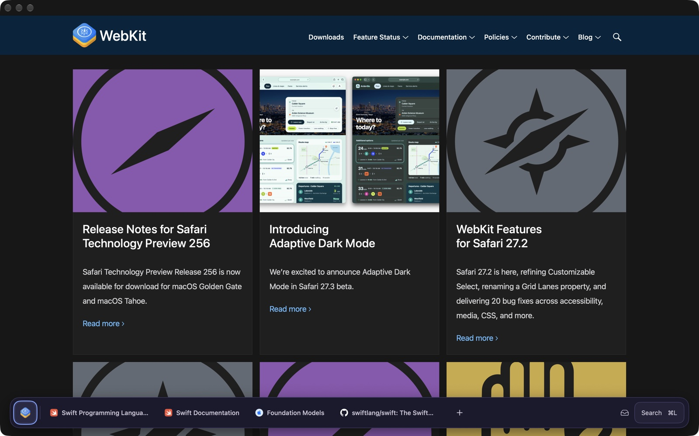
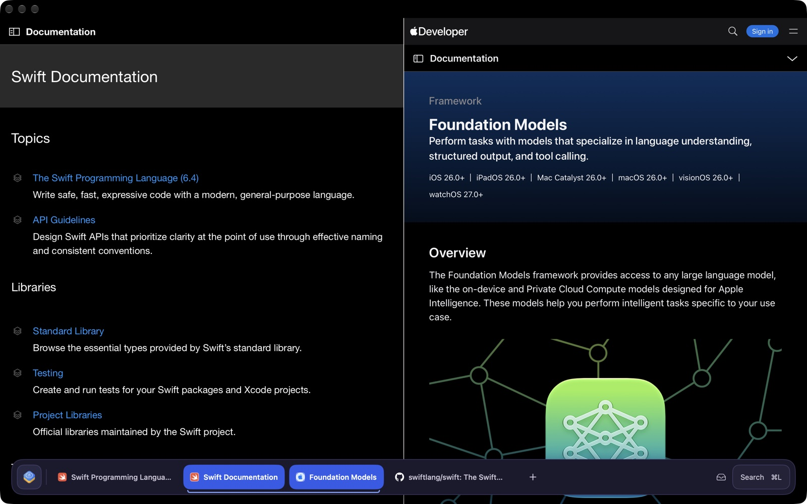
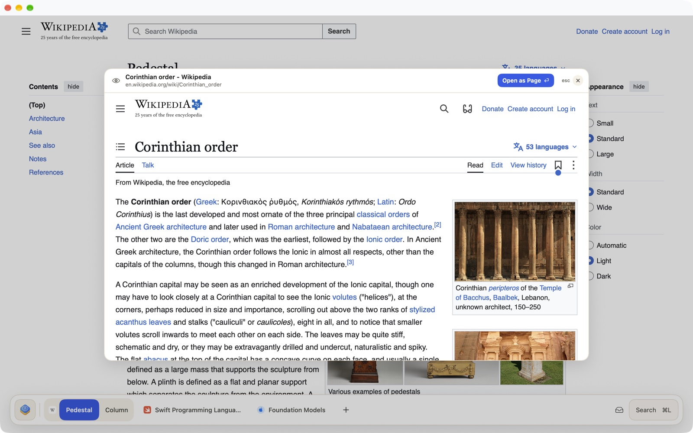
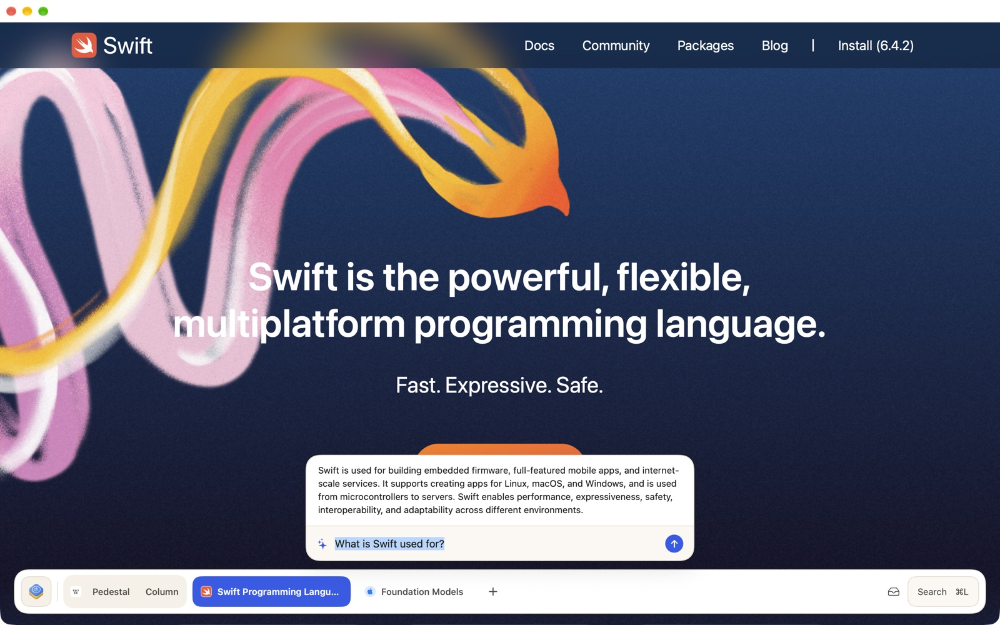
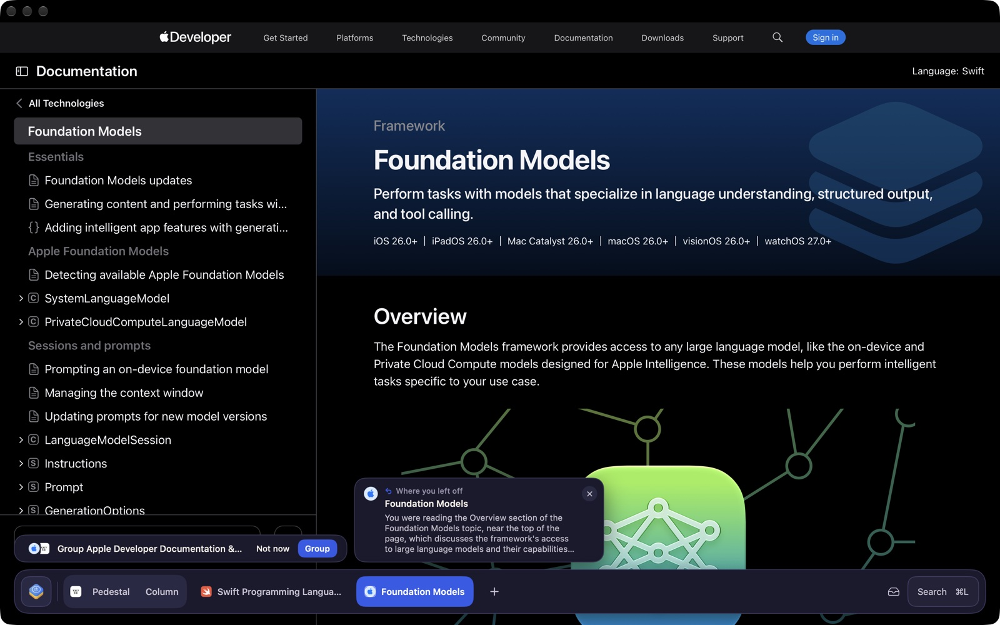
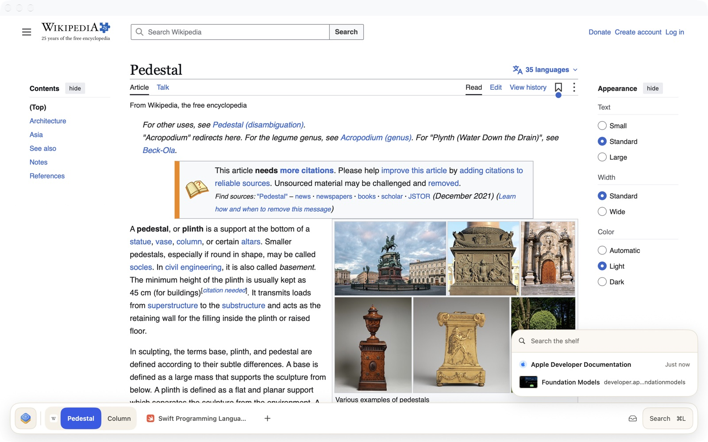
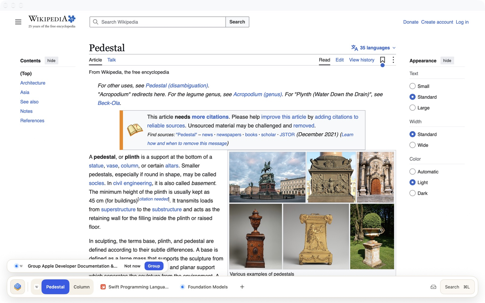
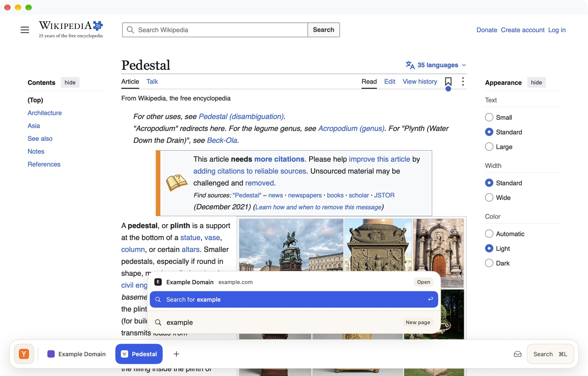

<p align="center">
  
</p>

<p align="center">
  <strong>A calm, native macOS browser with one floating bar instead of tabs.</strong><br>
  Swift · WebKit · on-device AI · no tracking
</p>

<p align="center">
  <a href="LICENSE"></a>
  
  
  <a href="https://github.com/brandonzalcman/Plinth/actions/workflows/release.yml"></a>
</p>

<p align="center">
  
</p>

Plinth has no toolbar and no tab strip. The page runs to the top of the window, and the only chrome is a floating bar at the bottom. It lists your open pages by name, grouped by website. Sites you stop using fade out and drop onto a searchable shelf, so the bar stays short without you tidying it.

## Contents

- [Highlights](#highlights)
- [Install](#install)
- [Using Plinth](#using-plinth)
- [Keyboard shortcuts](#keyboard-shortcuts)
- [Build from source](#build-from-source)
- [Architecture](#architecture)
- [Privacy](#privacy)
- [Releasing](#releasing)
- [Contributing](#contributing)
- [Known limits](#known-limits)
- [License](#license)

## Highlights

| | |
|---|---|
| **One bar, grouped by site.** Pages from the same website share a capsule led by its icon. The bar goes light over light pages and dark over dark ones. | **Adaptive fading.** A site you use every day stays; a one-off search fades within a day. Pinned and kept sites never fade. |
| **Split view.** Drag one page onto another, or use View › Split View With. | **Peek.** ⇧-click any link to preview it in a card, then press ↩ to keep it as a page. |
| **Ask page / ask site.** ⌘J asks the on-device model about the current page, every page of the site, or compares the two halves of a split. | **Resume cards.** When a site comes back from the shelf, a short "where you left off" card reminds you what you were reading. |
| **Semantic history.** Search finds pages by what they were about, listed under "By meaning". | **Group suggestions.** Sites you keep open together can become a group; one click shows only that group. |

<table>
  <tr>
    <td></td>
    <td></td>
  </tr>
  <tr>
    <td align="center"><sub>Split view, both pages joined on the bar</sub></td>
    <td align="center"><sub>Peek a link without leaving the page</sub></td>
  </tr>
  <tr>
    <td></td>
    <td></td>
  </tr>
  <tr>
    <td align="center"><sub>Ask the page, answered on device</sub></td>
    <td align="center"><sub>Resume card when a site returns from the shelf</sub></td>
  </tr>
  <tr>
    <td></td>
    <td></td>
  </tr>
  <tr>
    <td align="center"><sub>The shelf: faded sites, searchable</sub></td>
    <td align="center"><sub>A gentle suggestion to group sites</sub></td>
  </tr>
</table>

Also included:

- **Pinned sites.** A pin is a small resident app with one page. A link that leaves the pin's site opens as an ordinary page, and sign-in flows keep working.
- **Mini window.** Links opened from other apps get a small window with no bar; ⌘⇧↩ moves the page into your main window.
- **Content blocking.** A built-in ad and tracker blocker.
- **Downloads, find in page, zoom,** and reopen closed page.
- **iCloud sync.** Pins, the shelf and history sync, plus each Mac's open pages as a read-only list. This is built and tested but off by default; see [Known limits](#known-limits).

## Install

**[Download Plinth for Mac](https://github.com/brandonzalcman/Plinth/releases/latest/download/Plinth.dmg)** (macOS 26 or later). Open the disk image and drag Plinth to Applications. It's signed and notarized, and it updates itself: you'll get new versions automatically, or choose **Plinth › Check for Updates…**.

To make Plinth your default browser, choose it under System Settings › Desktop & Dock › Default web browser.

Prefer to build it yourself? See [Build from source](#build-from-source).

## Using Plinth

**Open a page.** Press ⌘L or ⌘T and type an address or a search. The command bar also finds open pages, pins, shelved pages and history. Results found by meaning appear under their own heading.

<p align="center"></p>

**Work with the bar**
- Click a page to switch to it, and middle-click or hover then press × to close it.
- Drag a page or a site to reorder it.
- Rest one page on another to split them.
- Right-click a page to rename it, keep its site, pin it, put it away or split with it.

**The shelf.** Sites you stop using drop onto the shelf. Click the tray at the right of the bar, or press ⇧⌘L. Pick a page to bring it back where it was.

**Ask.** Press ⌘J, type a question and press ↩. Choose "This page", "All *site* pages", or "Compare split" while a split is on screen. Answers stream in, and Stop ends one early.

**Groups.** When the same sites have been open together for a while, a small pill offers to group them. Choose **Group** and the bar shows only those sites; **Show all** brings everything back. **Not now** changes nothing.

**Turn AI off.** Plinth menu › Use On-Device AI switches off every model feature at once. Keyword search and the rest of the browser keep working.

## Keyboard shortcuts

| Action | Keys |
|---|---|
| New page / search or enter address | ⌘T / ⌘L |
| Close page, reopen closed page | ⌘W, ⇧⌘T |
| Next / previous page | ⇧⌘] / ⇧⌘[ |
| Go to page 1–9 (left to right) | ⌘1 … ⌘9 |
| Show shelf | ⇧⌘L |
| Find in page | ⌘F |
| Ask about this page | ⌘J |
| Split with next page / end split | ⌥⌘\\ / ⇧⌘\\ |
| Keep site on bar, pin site, put site away | ⇧⌘K, ⇧⌘P, ⇧⌘E |
| Peek a link | ⇧-click |
| Open peek as a page | ↩ |
| Move mini window page to main window | ⇧⌘↩ |
| Back / forward, reload | ⌘[ / ⌘], ⌘R |

## Build from source

### Requirements

- macOS 26 (Tahoe) or later
- Xcode 26 with Swift 6.2
- For the AI features, a Mac that supports Apple Intelligence, with it turned on. Everything else works on any Mac running macOS 26.

### Build, test, bundle

```bash
swift build
```

```bash
swift test
```

```bash
Scripts/bundle.sh
```

`Scripts/bundle.sh [debug|release]` builds `build/Plinth.app` from the command line and signs it ad hoc. It's handy for quick local builds, but signed builds and iCloud need the Xcode project below.

### Open in Xcode

`Plinth.xcodeproj` is the app project. It holds the real app bundle settings: `Info.plist`, entitlements, the icon, signing and archiving. All of the code lives in the Swift package, which the project links as the `PlinthApp` library.

```bash
open Plinth.xcodeproj
```

1. Choose the **Plinth** scheme and **My Mac**, then press ⌘R. It builds and runs with "Sign to Run Locally", so no Apple developer account is needed.
2. To sign with your own team, go to the **Plinth** target › **Signing & Capabilities** and choose your **Team**. That's also where you add iCloud; see [docs/icloud-sync.md](docs/icloud-sync.md).
3. To ship it, use **Product › Archive**, then **Distribute App** (Developer ID with notarization, or the Mac App Store).

Run the tests with `swift test`, or open `Package.swift` in Xcode and press ⌘U.

If `swift` complains about a missing SDK, `xcode-select` is probably pointing at the Command Line Tools. Either switch it to Xcode, or prefix commands like this:

```bash
DEVELOPER_DIR=/Applications/Xcode.app/Contents/Developer swift build
```

### Try it without touching your profile

Plinth keeps its data in `~/Library/Application Support/Plinth`. For experiments, point it at a throwaway folder:

```bash
open -n build/Plinth.app --env PLINTH_STORAGE=/tmp/plinth-test --env PLINTH_OPEN=https://www.swift.org,https://webkit.org
```

| Variable | Effect |
|---|---|
| `PLINTH_STORAGE` | Profile folder (state, favicons, semantic index, settings) |
| `PLINTH_OPEN` | Comma-separated URLs to open at launch |
| `PLINTH_AI=fake` | Use a deterministic fake model, so the AI interface works on any Mac |
| `PLINTH_STEPS` | Run a scripted sequence of steps for testing (see `Sources/PlinthApp/DebugScript.swift`) |
| `PLINTH_SHOTS` | Folder for screenshots taken by `PLINTH_STEPS` |

## Architecture

Plinth is a single Swift package. Each module has one job, and modules talk through the value types and protocols in `PlinthModel`.

```
PlinthModel ── contracts (value types, protocols)
   ├─ PlinthRules    site identity, page naming, address resolver, pinned-link policy
   ├─ PlinthFade     adaptive page and site fading
   ├─ PlinthLayout   bar overflow: collapse, shorten, then scroll
   ├─ PlinthStore    BrowserStore: windows, pins, shelf, history, search, groups, persistence
   ├─ PlinthAI       chunk-and-summarise, resume cards, ask, semantic index
   ├─ PlinthSync     record mapping, merge rules, in-memory and CloudKit transports
   ├─ PlinthWeb      WKWebView pool, content blocker, peek and mini views, downloads, readable text
   ├─ PlinthBarUI    the bottom bar (SwiftUI)
   └─ PlinthPanels   command bar, shelf, find, ask, peek, resume card, groups, downloads
PlinthApp ── the app shell that wires them together (a library)
   ├─ Plinth            SwiftPM executable (swift run, Scripts/bundle.sh)
   └─ Plinth.xcodeproj  the Xcode app target: Info.plist, entitlements, signing, archive
```

- The store has no WebKit or UI. It emits events, and the shell turns them into web view work.
- The AI module hides Apple's frameworks behind `TextGenerating` and `TextEmbedding`, so the store and shell never import them, and tests use fakes.
- Apple's on-device model has a small context, so long pages go through a chunk-and-summarise pipeline that keeps every request within budget.

More detail is in [`docs/`](docs): the [brand guide](docs/brand-guide.md) and the [iCloud sync design](docs/icloud-sync.md).

## Privacy

- **No accounts, analytics or telemetry.**
- **All AI runs on your Mac.** It uses Apple's Foundation Models and NaturalLanguage frameworks. Page text is never sent anywhere, and the embedding index is a local file in your profile.
- **Only long reads are indexed.** Semantic history covers only pages you spent 30 seconds or more on, and one switch turns all AI off.
- **iCloud sync is off by default.** When enabled, it would use your own private iCloud database.

## Releasing

Releases are a signed, notarized `Plinth.dmg` on GitHub Releases, with Sparkle auto-updates. Pushing a tag like `v0.2.0` runs the whole pipeline. One-time setup and details are in [RELEASING.md](RELEASING.md).

## Contributing

Contributions are welcome. See [CONTRIBUTING.md](CONTRIBUTING.md) for setup, conventions and how to send a pull request. Please report security issues privately, as described in [SECURITY.md](SECURITY.md).

Good first areas:
- Fixing bugs you hit in daily use.
- Adding tests for the pure modules (`PlinthRules`, `PlinthFade`, `PlinthLayout`, `PlinthStore`, `PlinthAI`, `PlinthSync`).
- Improving accessibility of the bar and panels.

## Known limits

- **iCloud sync** needs an Apple developer team. Choose your team and add the iCloud capability in `Plinth.xcodeproj`; the ad-hoc build can't use iCloud. [docs/icloud-sync.md](docs/icloud-sync.md) has the steps.
- **System Passwords autofill** needs Apple's web-browser entitlement, which an open-source build does not have.
- **Semantic search** quality depends on Apple's NaturalLanguage sentence embeddings, so "By meaning" results come after keyword results.
- **No extensions,** by design.

## License

Plinth is free software: you can redistribute it and modify it under the terms of the [GNU General Public License v3.0](LICENSE).
